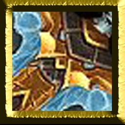
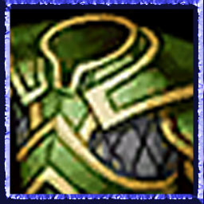
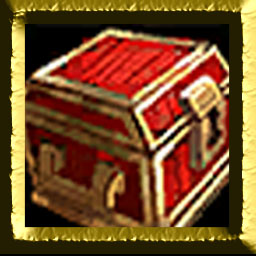
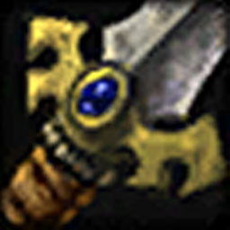
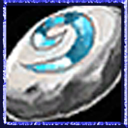

## My Digital Archive
<a href="https://ob1nic.github.io/Digital-Archive/" target="_blank" rel="noopener noreferrer">Digital Archive</a>

## Challenges

<h3>Google KickStarter</h3>

  
  

<!--
<h3>LeetCode, CodeWars and HackerRank</h3>

  
  
  

-->

## These are a few languages and tools I use often:

<h3>Programming, Frameworks and Libraries</h3>
<table>
  <tr>
    <td valign="middle" width="70">
      
    </td>
    <td valign="middle">
      
      
       
      <!--  -->
      <!--  -->
      
      
      
      
      
      
    </td>
  </tr>
</table>

<h3>Markup Languages</h3>
<table>
  <tr>
    <td valign="middle" width="70">
      
    </td>
    <td valign="middle">
      
      
      
    </td>
  </tr>
</table>

<h3>Version Control and Development</h3>
<table>
  <tr>
    <td valign="middle" width="70">
      
    </td>
    <td valign="middle">
      
      
      
      
      
      
      
      
      
    </td>
  </tr>
</table>
<!--
<h3>Artificial Intelligence (Striving Fluency)</h3>
<table>
  <tr>
    <td valign="middle" width="70">
      
    </td>
    <td valign="middle">
      
      
      
      
      
    </td>
  </tr>
</table>
-->

<h3>Software and Tools</h3>
<table>
  <tr>
    <td valign="middle" width="70">
      
    </td>
    <td valign="middle">
      
      
      
      
      
      
      
      
      
      
            
      
      
      
      
      
      
      
      
      
      
      
      
      
      
      
      
      
      
      
      
    </td>
  </tr>
</table>

## Languages I Speak and Learning

## Find Me Online

  

